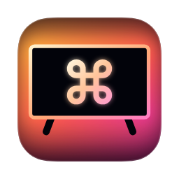
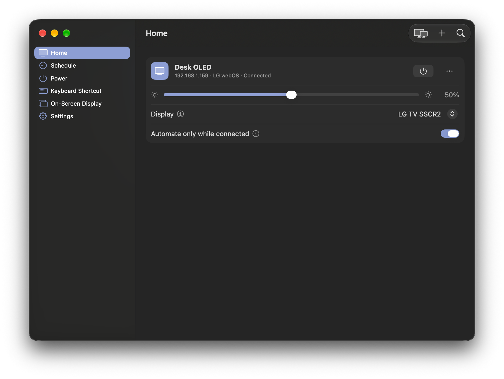
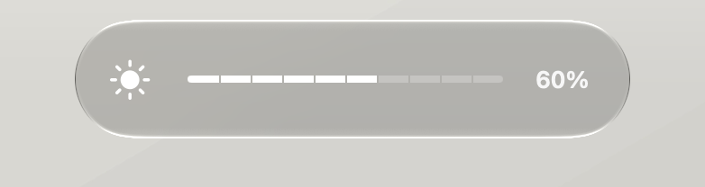
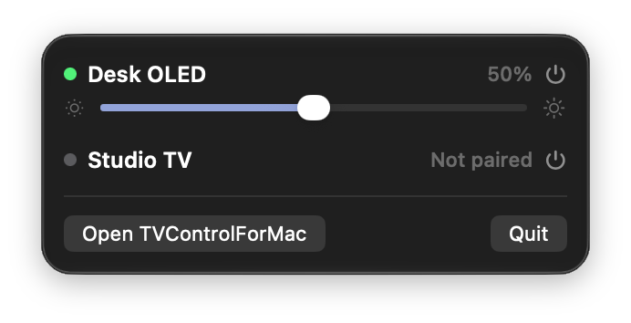
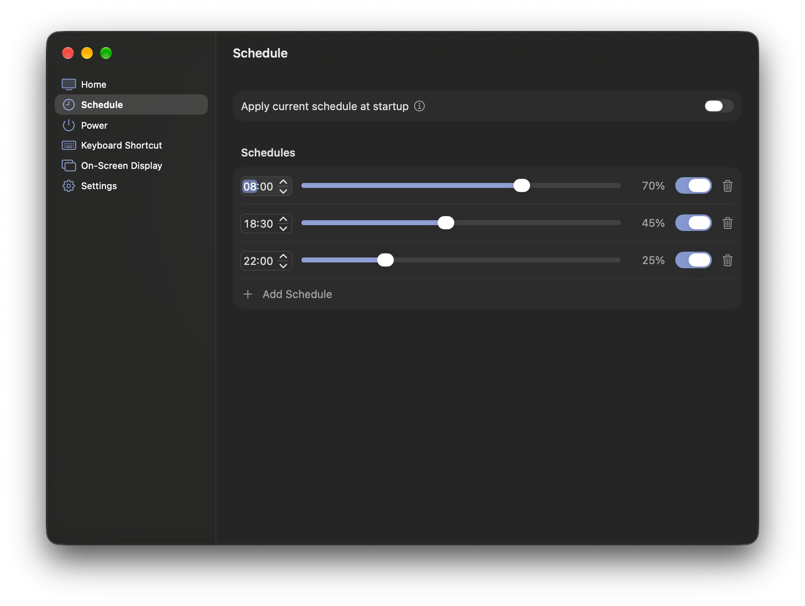
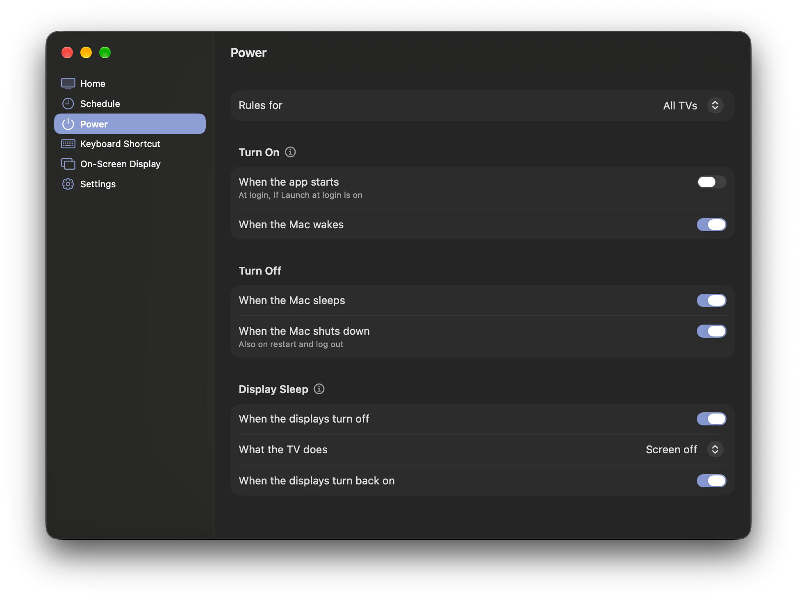
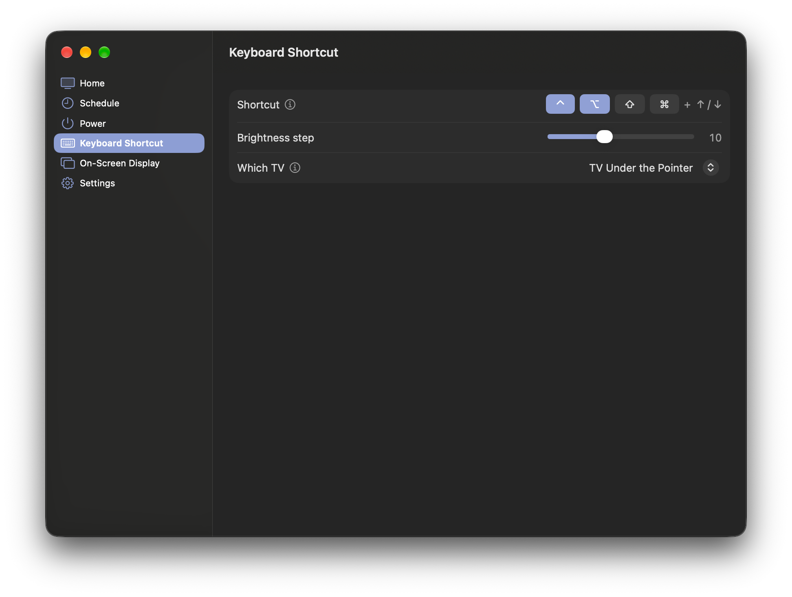
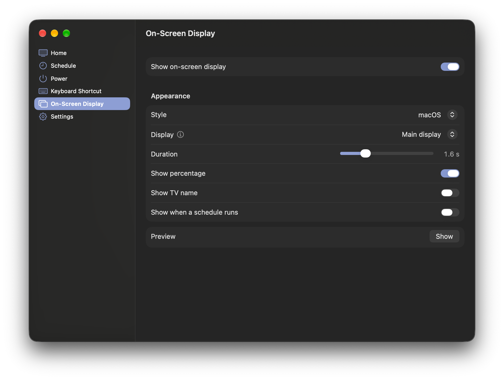
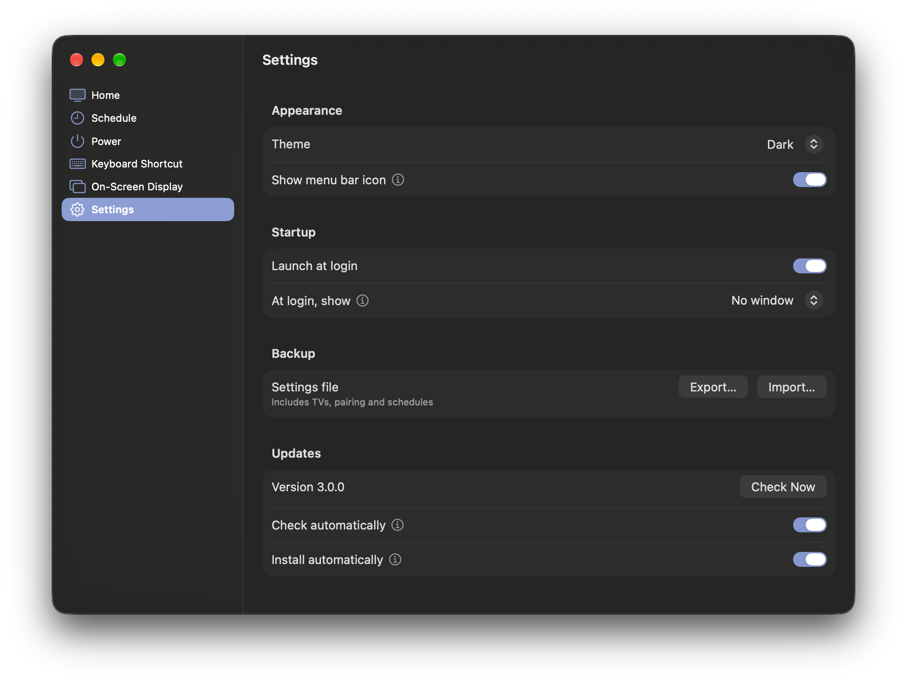

  

<h1 align="center">TVControlForMac</h1>

  
  
  
  
  

  <b>Change your TV's brightness and switch it on and off from your Mac.</b> 
  A small native app for TVs used as monitors. Works with LG and Google TV, over your home network.

  

   
  

  Press <code>⌃⌥↑ / ⌃⌥↓</code> and a brightness pop-up appears below the menu bar, like the Mac's own.

  <a href="#what-it-does">What it does</a> ·
  <a href="#which-tvs-work">Which TVs work</a> ·
  <a href="#install">Install</a> ·
  <a href="#set-up-your-tv">Set up your TV</a> ·
  <a href="#using-it">Using it</a> ·
  <a href="#if-something-isnt-working">Help</a> ·
  <a href="#contributing">Contributing</a>

## Why

If you use a TV as a monitor, you know the two annoyances: the Mac's brightness keys do
nothing to it, and the TV stays on when the Mac goes to sleep. TVControlForMac talks to the
TV over your home network and takes care of both.

It's the Mac counterpart of [the Windows version](https://github.com/itsAllexB/TVControlForWin).

## What it does

<table>
  <tr>
    <td width="50%" valign="top"><b>Brightness slider</b> One for each TV, in the menu bar and in the app's window.</td>
    <td width="50%" valign="top"><b>Keyboard shortcut</b> <code>⌃⌥↑ / ⌃⌥↓</code> changes the TV your pointer is on, with a small pop-up like the Mac's own.</td>
  </tr>
  <tr>
    <td valign="top"><b>Schedules</b> Bright in the morning, dim at night, or whatever suits you.</td>
    <td valign="top"><b>Power that follows the Mac</b> The TV turns on when you log in or the Mac wakes, and off when it sleeps, shuts down or the displays turn off.</td>
  </tr>
  <tr>
    <td valign="top"><b>Lives in the menu bar</b> No Dock icon while the window is closed. Can open at login.</td>
    <td valign="top"><b>Knows when you've left the desk</b> Take a MacBook away from the TV and the TV is left alone until you're back.</td>
  </tr>
  <tr>
    <td valign="top"><b>Keeps itself up to date</b> New versions arrive by themselves.</td>
    <td valign="top"><b>Moves between Mac and Windows</b> A settings backup from the Windows version imports here, pairing included, and the other way round.</td>
  </tr>
</table>

## Which TVs work

| TV | Brightness | On / off |
|---|:-:|:-:|
| **LG** with webOS (C2, C3, G-series and similar) | ✅ | ✅ |
| **TCL** with Google TV | ✅ after a [one-time setup](#brightness-on-a-tcl) | ✅ |
| Other **Google TV / Android TV** (Sony, Philips, Hisense, Xiaomi, Chromecast…) | not yet | ✅ |

Samsung, Roku, Fire TV and Hisense VIDAA TVs are not supported.

Tested on an LG OLED42C3 and a TCL 65C765. No rooting or developer firmware needed.

## Install

You need macOS 14 Sonoma or newer, on Apple silicon or Intel.

1. Download **`TVControlForMac-….dmg`** from the
   [latest release](https://github.com/itsAllexB/TVControlForMac/releases/latest), open it
   and drag **TVControlForMac** to **Applications**. Prefer a zip? Take
   **`TVControlForMac-….zip`**, unzip it and move the app to **Applications**.
2. The first time, macOS refuses to open it, because the app isn't notarized by Apple yet.
   Open it once and close the message that appears. Then go to
   **System Settings → Privacy & Security**, scroll down to the message about
   TVControlForMac, select **Open Anyway** and confirm. On macOS 15 and later that is the
   only way; on macOS 14 you can also Control-click the app and choose **Open**.
3. When macOS asks whether TVControlForMac may find devices on your local network, select
   **Allow**. Without it the app can't reach any TV.

Coming from LGforMac? Install TVControlForMac and open it. Your TVs, pairing and settings
carry over, **Launch at login** included, and an LGforMac that's still running is closed
for you. macOS asks about the local network again, because to it this is a new app. You
can then move LGforMac to the Trash. If it opened at login, also switch it off under
**System Settings → General → Login Items**.

## Set up your TV

1. Make sure the TV is on, and on the same network as the Mac.
2. Open TVControlForMac and select **Find TVs** (the magnifying glass in the toolbar). Pick
   your TV and select **Add**. You can also select **+**, type the TV's IP address and
   select **Add TV**.
3. Pair it, once:
   - **LG**: accept the prompt that appears on the TV.
   - **Google TV**: the TV shows a code. Type it into the app and select **Confirm**.
4. More than one display? On each TV's card, choose which **Display** it is. That's how
   the keyboard shortcut knows which TV your pointer is on. **Identify Displays** in the
   toolbar shows each display's name on that display.

### Brightness on a TCL

TCL keeps brightness behind Android's debugging switch, so it needs turning on once:

1. On the TV, open **Settings → System → About** and press OK on **Android TV OS build**
   seven times.
2. Open **Settings → System → Developer options** and turn on **USB debugging**. (No USB
   cable involved. On a TV this switch also covers the network.)
3. In the app, select **Set Up** on the TV's card.
4. On the TV, tick **Always allow** and select **Allow**.

The TV then gets a slider and works with schedules and the shortcut like an LG does.

### Letting the Mac turn the TV on

A TV can only be woken while it stays connected in standby. That's a setting on the TV:

- **LG**: turn on **Quick Start+** (also called *Turn on via Wi-Fi*, depending on the model).
- **Google TV**: **Settings → System → Power & Energy → Energy Modes → Increased**.
  Older models call it *Quick start* or *Wake on LAN*.

The app also needs to have reached the TV once while it was on. Turning the TV *off* from
the Mac works without any of this.

## Using it

### Menu bar

Click the app's icon in the menu bar for a brightness slider and a power button for each
TV. **Open TVControlForMac** brings back the window, and **Quit** quits the app.

  

Closing the window leaves the app running in the menu bar, with no Dock icon. If you hide
the menu bar icon in **Settings**, the app keeps running in the background; open it again
to get the window back.

### Keyboard shortcut

`⌃⌥↑` and `⌃⌥↓` (Control-Option-Up Arrow and Down Arrow) change brightness by 10. On the
**Keyboard Shortcut** page you can change the modifier keys, the step, and whether the shortcut
controls the TV under the pointer, all TVs, or always the same one.

The pop-up that appears has two styles on the **On-Screen Display** page: **macOS**, below
the menu bar like the system's own, and **Windows**, a bar you can put in one of six
places. You can also show it on a different display, or switch it off.

### Schedules and power

<table>
  <tr>
    <td width="50%" valign="top"><b>Schedule</b>: up to 10 times of day, each for all TVs or only some</td>
    <td width="50%" valign="top"><b>Power</b>: one set of rules for all TVs, or separate rules per TV</td>
  </tr>
  <tr>
    <td valign="top"></td>
    <td valign="top"></td>
  </tr>
</table>

A schedule that runs while a TV is off isn't lost: the TV gets that brightness the moment
it's back.

**Screen off** blanks an LG's panel and brings the picture back instantly. Keep in mind
that most TVs switch themselves off after a few minutes without a signal, so turn on
**When the displays turn back on** with it. Google TVs can't blank the panel and turn off
instead.

On a MacBook that leaves the desk, choose the TV's **Display** on its card and turn on
**Automate only while connected**. Schedules, power rules and the shortcut then leave that TV alone while its display
isn't connected to this Mac. A schedule missed meanwhile is applied when you plug it back
in.

### Everything else

<table>
  <tr>
    <td width="50%" valign="top"><b>Keyboard Shortcut</b></td>
    <td width="50%" valign="top"><b>On-Screen Display</b></td>
  </tr>
  <tr>
    <td valign="top"></td>
    <td valign="top"></td>
  </tr>
  <tr>
    <td valign="top"><b>Settings</b>: theme, menu bar icon, launch at login, backup, updates</td>
    <td></td>
  </tr>
  <tr>
    <td valign="top"></td>
    <td></td>
  </tr>
</table>

## Updates

About once a day the app checks this page's releases for a newer version. It only installs
files from those releases, and checks each one before it does.

| Your copy | What happens |
|---|---|
| In **Applications**, or another folder you can write to | Downloads and installs by itself while the window is closed. |
| The same, with **Install automatically** off | Downloads, then waits for you to select **Install** in **Settings**. A dot on **Settings** in the sidebar tells you it's ready. |
| Opened straight from the disk image or from Downloads, or in a folder you can't write to | Tells you there's a new version and opens the download page. |

Both the daily check and the automatic install can be switched off under
**Settings → Updates**.

## Privacy

- The app talks to your TVs over your own network. Nothing about you or your TVs is sent
  anywhere.
- The only time it goes online is to check GitHub for a new version and download it.
- Your TVs and settings are saved on your Mac, in
  `~/Library/Application Support/TVControlForMac`.
- A settings backup (**Settings → Backup → Export…**) contains the keys your TVs gave the
  app when you paired them. Keep that file to yourself.

## If something isn't working

**macOS says it can't open the app.**
The app isn't notarized yet. Allow it once in **System Settings → Privacy & Security**, as
in step 2 of [Install](#install).

**The Home page says "Can't reach your TVs".**
macOS is probably keeping the app off your local network. Open
**System Settings → Privacy & Security → Local Network** and turn on TVControlForMac
(**Open Settings** on that row gets you there). If the app isn't listed, select
**Ask Again** and allow the prompt that appears.

**Find TVs doesn't find my TV.**
Check that the TV is on and on the same network (not a guest Wi-Fi). On older LG models,
turn on **LG Connect Apps** in the TV's network settings. You can always add the TV by its
IP address instead.

**The TV's card says "Can't reach the TV".**
The TV is off or has left the network. Hold the pointer over that line for what to check.

**The Mac can't turn the TV on.**
See [Letting the Mac turn the TV on](#letting-the-mac-turn-the-tv-on). A TV that has just
installed a system update may also need switching on by hand once.

**My Google TV says "Power only" and has no slider.**
Brightness works on TCL so far. Other brands keep that setting somewhere the app can't
reach yet. Switching on and off works on all of them.

**"No TV on this display" pops up when I press the shortcut.**
The app doesn't know which TV that display is. Choose a **Display** on each TV's card.

**"TV isn't connected" pops up when I press the shortcut.**
That TV has **Automate only while connected** on, and its display isn't connected to this
Mac.

**How do I remove it?**
Select **Quit** in the menu bar pop-up, then drag TVControlForMac from **Applications** to
the Trash. Your settings stay in `~/Library/Application Support/TVControlForMac`; delete
that folder too if you want them gone.

Still stuck? [Open an issue](https://github.com/itsAllexB/TVControlForMac/issues) and say
which TV model and which version of macOS you have.

## Contributing

Contributions are welcome, and support for more TVs most of all.

- **Have a TV that isn't supported, or a Google TV without the brightness slider?**
  [Open an issue](https://github.com/itsAllexB/TVControlForMac/issues) with the model.
  A plain "this works on my TV" report helps too.
- **Want to add your TV's brand?** [Adding a TV brand](docs/development.md#adding-a-tv-brand)
  shows where it plugs in, and how the TCL brightness call was found.
- **Found a bug or have an idea?** Issues and pull requests are both fine.

[CONTRIBUTING.md](CONTRIBUTING.md) has the details. To build, run `./build.sh debug --run`
(needs Xcode or the Command Line Tools). How the app talks to each kind of TV and how the
project is laid out is in [docs/development.md](docs/development.md), and plans live in
[Todo.md](Todo.md).

## License

Copyright © 2026 Alex Bolocan.

TVControlForMac is free software: you can redistribute it and/or modify it under the terms
of the [GNU Affero General Public License](LICENSE) as published by the Free Software
Foundation, either version 3 of the License, or (at your option) any later version
(`AGPL-3.0-or-later`).

It is distributed in the hope that it will be useful, but WITHOUT ANY WARRANTY; without even
the implied warranty of MERCHANTABILITY or FITNESS FOR A PARTICULAR PURPOSE. See the
license for details.

Versions up to 1.0, published as LGforMac, were licensed under GPL-3.0 and remain
available under it. The app contains no third-party code; see
[THIRD-PARTY-NOTICES.md](THIRD-PARTY-NOTICES.md).
